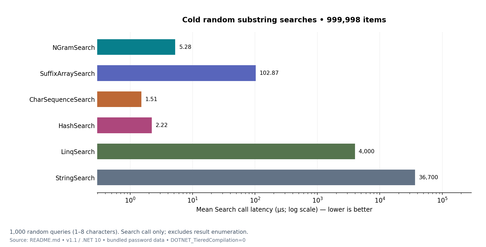
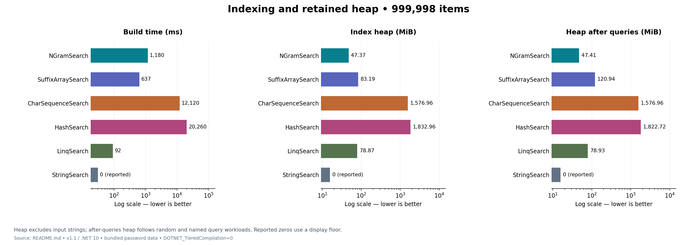
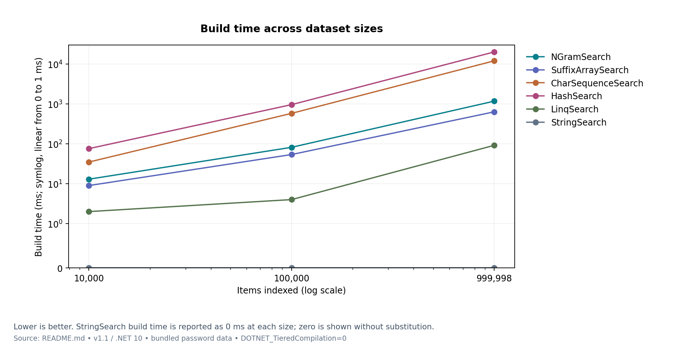
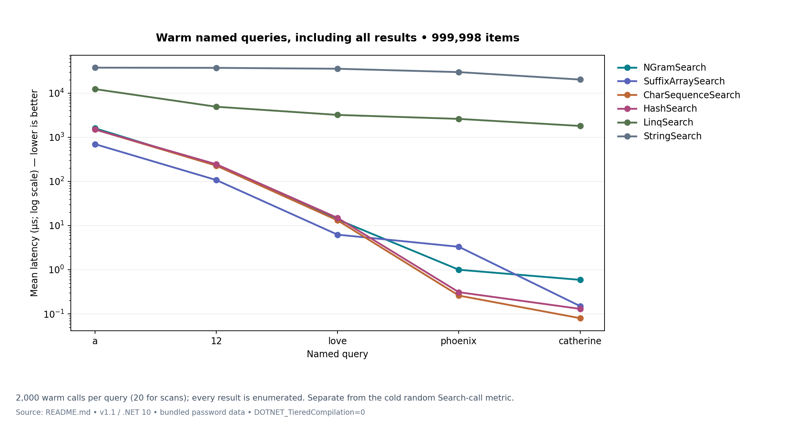
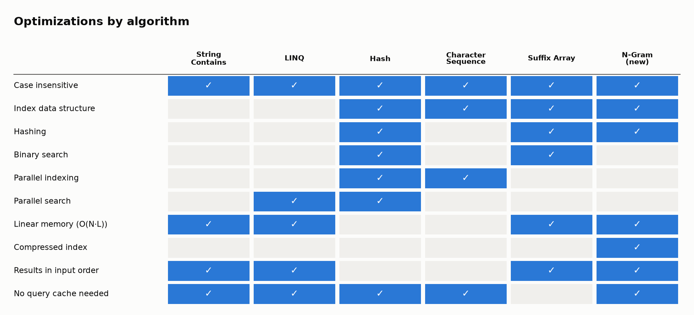

# **FastSearch**

[](https://www.nuget.org/packages/FastSearch)
[](https://www.nuget.org/packages/FastSearch)
[](https://github.com/MILL5/FastSearch/actions/workflows/ci.yml)
[](https://dotnet.microsoft.com/download/dotnet/10.0)
[](LICENSE)
## _Lightning-fast, low-memory substring search for .NET_

FastSearch is an open-source C# library for case-insensitive substring search ("contains" search) over in-memory collections of objects: autocomplete, type-ahead, filtering, and lookups across millions of items.

**Current release:** [FastSearch 1.1.1](https://www.nuget.org/packages/FastSearch/1.1.1). This patch updates the documentation; the algorithms and recorded benchmark measurements are unchanged from 1.1.0.

✨ **Features**
- **Effortless searching:** case-insensitive substring matches across large lists of objects through one interface, `ISearch<T>`.
- **Multiple search algorithms:**
  - **NGramSearch** *(new in 1.1, recommended)*: compressed n-gram posting lists. At 1M items it indexes in about 1 s with **47 MiB** of memory, and answers a typical random query in about **5 µs**. That is 30× less memory than the trie and 20× faster than the suffix array on cold queries.
  - **SuffixArraySearch** *(new in 1.1)*: generalized suffix array with a 1/2/3-character prefix table. Fastest at enumerating very broad results; memoizes broad queries.
  - **CharSequenceSearch**: suffix trie with a precomputed result list at every node. Fastest for narrow queries, but memory grows as O(N·L²) (1.5 GiB at 1M items).
  - **HashSearch**: precomputed hash of every substring. Speed is similar to the trie, and it uses the most memory.
  - **LinqSearch**: parallel LINQ scan over lowercased copies of the strings, with no index.
  - **StringSearch**: single-threaded `Contains` scan, with no index. Used as the baseline the other algorithms are checked against.
- **Customizable object representation:** override `ToString()` or pass a custom index function that returns the strings to index for each item.

🚀 **Quick Start**
1. Install the **FastSearch** package from NuGet: `dotnet add package FastSearch --version 1.1.1`.
2. Override `ToString()` on your objects, or pass an index function.
3. Create an `NGramSearch` with your `IEnumerable<T>`, then call `Search`.

```csharp
using System.Collections.Generic;
using FastSearch;

var search = new NGramSearch<Customer>(customers, c => new[] { c.Name, c.Email });
ICollection<Customer> hits = search.Search("phoe"); // case-insensitive; each matching input position once, in order
```

The example assumes your existing `customers` collection and `Customer` class. Null or empty queries return no results across all six algorithms. Result ordering and duplicate handling vary by algorithm; `NGramSearch` returns each matching input position once, even when several fields match. Repeating an object at multiple input positions can return that object more than once.

**Targets:** `net10.0` (.NET 10 LTS). Version 1.1 drops `netstandard2.1`, because every .NET runtime it served (.NET Core 3.x through .NET 9) is out of support or reaches end of support in November 2026. Stay on FastSearch 1.0.16 if you need an older runtime. The tests, benchmarks and the WPF sample also target .NET 10.

### **Which algorithm should I use?**

| If you need… | Use |
|---|---|
| The best all-round choice: small memory, fast build, fast queries | **NGramSearch** |
| The fastest enumeration of very broad results (1–2 character queries over millions of items) | SuffixArraySearch |
| The lowest latency on narrow queries, and memory is no concern (small lists) | CharSequenceSearch |
| A parallel scan over a snapshot, without a substring index | LinqSearch |
| A simple scan that reads the source and indexed fields on every query | StringSearch |
| Precomputed substring answers with hash lookup, when memory is no concern | HashSearch |

`NGramSearch`, `SuffixArraySearch`, `CharSequenceSearch`, `HashSearch`, and `LinqSearch` capture indexed text at construction. Rebuild them when the source collection or indexed fields change. `LinqSearch` still allocates lowercased string copies; its lack of a substring index does not mean zero memory.

### **Algorithm specifications**

- [NGramSearch](docs/NGramSearch-Spec.md): compressed posting lists and candidate verification.
- [SuffixArraySearch](docs/SuffixArraySearch-Spec.md): sorted suffixes, prefix tables, and bounded result caching.
- [CharSequenceSearch](docs/CharSequenceSearch-Spec.md): suffix trie and optional exact matching.
- [HashSearch](docs/HashSearch-Spec.md): substring hashes with collision checking.
- [LinqSearch](docs/LinqSearch-Spec.md): parallel scan over lowercased text snapshots.
- [StringSearch](docs/StringSearch-Spec.md): direct scan and correctness baseline.

### **How NGramSearch works**

- **Index:** every distinct 1-, 2- and 3-character substring of an item, plus every 4-character substring shared by 16 or more items, maps to the sorted list of item ids that contain it. Each list is delta + varint encoded (about 1–2 bytes per entry), or stored as a bitmap when that's smaller.
- **Short queries (1–3 characters, and common 4-character ones):** answered exactly from a single list. There's no sorting, no de-duplication and no cache. The result is a lazy read-only view; its `Count` is known up front and items are decoded as you enumerate them.
- **Longer queries:** intersect the rarest gram lists, then verify the few remaining candidates against a compact lowercased copy of the text (1 byte per character for Latin-1 text).
- **Guarantees:** results come back in input order with no duplicates, the index never grows after it's built, and concurrent searches are safe.
- **Full details:** [NGramSearch-Spec.md](docs/NGramSearch-Spec.md). The suffix trie is described in [CharSequenceSearch-Spec.md](docs/CharSequenceSearch-Spec.md).

### **Performance & Memory (v1.1, .NET 10)**

**Cold query calls:** average time for 1,000 random substring queries. This measures the `Search` call, excluding result enumeration.



**Indexing cost:** build time, index heap, and retained heap after the query workload. Input strings are excluded from heap measurements.



**Build scaling:** how construction time changes from 10k to 100k and 999,998 items.



**Warm queries:** latency includes enumerating every result, so broad queries cost more than narrow ones.



**Implementation features:** which techniques each algorithm uses. This matrix describes implementation choices, not a performance ranking.



All numbers are apples-to-apples. Every algorithm indexes the same items (the first *N* entries of the bundled 1M-password list, 7.5 characters on average) on the same machine with the same method, and each measurement runs in its own process.

- **Index heap:** `GC.GetTotalMemory(true)` after the build minus before it, with the input strings already loaded so they aren't counted for any algorithm.
- **Heap after queries:** the same measurement taken after the 1,000 random queries and the warm named-query workload. It includes `SuffixArraySearch`'s bounded result cache. `NGramSearch` has no cache, so it doesn't retain query results.
- **Latency:** the named queries are averaged over 2,000 warm calls (20 for the scans) and include enumerating every result. The random mix is 1,000 cold queries of 1–8 characters and times the `Search` call only.
- **JIT:** all runs use `DOTNET_TieredCompilation=0`, so every algorithm runs fully optimized code from the first call.

**Memory vs. items stored**

| Items | Algorithm | Build time | Index heap | Bytes / char | Heap after queries |
|---:|---|---:|---:|---:|---:|
| 10,000 | **NGramSearch (new)** | 13 ms | 0.92 MiB | 14.4 | 0.92 MiB |
| 10,000 | SuffixArraySearch | 9 ms | 1.10 MiB | 17.3 | 1.51 MiB |
| 10,000 | CharSequenceSearch | 35 ms | 26.10 MiB | 411.5 | 26.10 MiB |
| 10,000 | HashSearch | 76 ms | 29.93 MiB | 471.9 | 29.94 MiB |
| 10,000 | LinqSearch | 2 ms | 0.77 MiB | 12.2 | 0.84 MiB |
| 10,000 | StringSearch | 0 ms | 0.00 MiB | 0.0 | 0.00 MiB |
| 100,000 | **NGramSearch (new)** | 82 ms | 4.73 MiB | 7.3 | 4.74 MiB |
| 100,000 | SuffixArraySearch | 54 ms | 8.20 MiB | 12.6 | 14.35 MiB |
| 100,000 | CharSequenceSearch | 583 ms | 187.45 MiB | 288.2 | 187.45 MiB |
| 100,000 | HashSearch | 964 ms | 215.01 MiB | 330.6 | 215.02 MiB |
| 100,000 | LinqSearch | 4 ms | 7.23 MiB | 11.1 | 7.30 MiB |
| 100,000 | StringSearch | 0 ms | 0.00 MiB | 0.0 | 0.00 MiB |
| 999,998 | **NGramSearch (new)** | 1.18 s | 47.37 MiB | 6.6 | 47.41 MiB |
| 999,998 | SuffixArraySearch | 637 ms | 83.19 MiB | 11.6 | 120.94 MiB |
| 999,998 | CharSequenceSearch | 12.12 s | 1.54 GiB | 219.0 | 1.54 GiB |
| 999,998 | HashSearch | 20.26 s | 1.79 GiB | 254.8 | 1.78 GiB |
| 999,998 | LinqSearch | 92 ms | 78.87 MiB | 11.0 | 78.93 MiB |
| 999,998 | StringSearch | 0 ms | 0.00 MiB | 0.0 | 0.00 MiB |

**Search latency** (sequential query calls; `LinqSearch` uses parallel workers)

| Items | Algorithm | `a` | `12` | `love` | `phoenix` | `catherine` | 1,000 random substrings (avg) |
|---:|---|---:|---:|---:|---:|---:|---:|
| 10,000 | **NGramSearch (new)** | 15.74 µs | 1.81 µs | 0.19 µs | 0.19 µs | 0.26 µs | 3.76 µs |
| 10,000 | SuffixArraySearch | 7.17 µs | 0.92 µs | 0.39 µs | 0.11 µs | 0.09 µs | 6.48 µs |
| 10,000 | CharSequenceSearch | 14.18 µs | 1.84 µs | 0.18 µs | 0.07 µs | 0.06 µs | 1.23 µs |
| 10,000 | HashSearch | 15.22 µs | 1.71 µs | 0.23 µs | 0.10 µs | 0.08 µs | 0.95 µs |
| 10,000 | LinqSearch | 181.40 µs | 90.78 µs | 79.01 µs | 43.45 µs | 24.90 µs | 72.58 µs |
| 10,000 | StringSearch | 357.41 µs | 344.37 µs | 368.39 µs | 228.93 µs | 128.67 µs | 317.52 µs |
| 100,000 | **NGramSearch (new)** | 133.86 µs | 28.98 µs | 1.56 µs | 0.37 µs | 0.23 µs | 4.66 µs |
| 100,000 | SuffixArraySearch | 57.56 µs | 13.84 µs | 0.73 µs | 0.21 µs | 0.11 µs | 13.16 µs |
| 100,000 | CharSequenceSearch | 120.86 µs | 29.48 µs | 1.46 µs | 0.11 µs | 0.06 µs | 1.25 µs |
| 100,000 | HashSearch | 115.21 µs | 28.61 µs | 1.40 µs | 0.15 µs | 0.10 µs | 1.38 µs |
| 100,000 | LinqSearch | 1.3 ms | 553.39 µs | 370.88 µs | 244.97 µs | 130.02 µs | 461.83 µs |
| 100,000 | StringSearch | 4.2 ms | 4.1 ms | 4.2 ms | 3.5 ms | 2.2 ms | 4.0 ms |
| 999,998 | **NGramSearch (new)** | 1.6 ms | 228.49 µs | 13.69 µs | 1.00 µs | 0.59 µs | 5.28 µs |
| 999,998 | SuffixArraySearch | 699.28 µs | 107.39 µs | 6.23 µs | 3.31 µs | 0.15 µs | 102.87 µs |
| 999,998 | CharSequenceSearch | 1.5 ms | 227.70 µs | 13.12 µs | 0.26 µs | 0.08 µs | 1.51 µs |
| 999,998 | HashSearch | 1.5 ms | 244.83 µs | 14.92 µs | 0.31 µs | 0.13 µs | 2.22 µs |
| 999,998 | LinqSearch | 12.3 ms | 4.9 ms | 3.2 ms | 2.6 ms | 1.8 ms | 4.0 ms |
| 999,998 | StringSearch | 37.6 ms | 37.2 ms | 35.5 ms | 29.8 ms | 20.2 ms | 36.7 ms |

**How to read this**

- **Memory:** `NGramSearch` needs about 7 bytes per indexed character on 100k items and above (more on small lists, where fixed overhead dominates), and it doesn't grow with queries. At 1M items that's 47 MiB, versus 83 MiB (121 MiB after queries) for `SuffixArraySearch` and 1.5–1.8 GiB for the trie and hash indexes.
- **Build time:** `NGramSearch` builds 1M items in about 1.2 s and `SuffixArraySearch` in about 0.6 s, versus 12–20 s for the trie and hash indexes.
- **Typical queries:** on the random mix, `NGramSearch` averages about 5 µs, which is close to the trie and hash indexes (1.5–2.2 µs) and 20× faster than `SuffixArraySearch` (103 µs). The suffix array has to collect and sort broad results before it can cache them.
- **Narrow, long queries:** the trie and hash indexes are still fastest (about 0.1–0.3 µs), because they store every possible answer ahead of time. `NGramSearch` takes about 1 µs.
- **Very broad queries:** enumerating hundreds of thousands of results dominates. `SuffixArraySearch` is fastest because it hands back a cached array; `NGramSearch` decodes its compressed list as you enumerate, which makes it slightly slower than the trie (1.6 ms versus 1.5 ms for `a` at 1M items).
- **No index:** `LinqSearch` and `StringSearch` use no index memory but scan everything on every query, taking milliseconds at 100k items and above.

**Fixes to existing algorithms in 1.1**

- **Faster indexing:** `CharSequenceSearch` and `HashSearch` checked for duplicates by scanning a `List` on every insert, which made indexing quadratic in the number of items. They now use an O(1) per-item visited set.
- **Exact-match case bug:** `CharSequenceSearch` exact-match mode compared mixed-case source strings to the lowercased query and missed matches. The comparison is now case-insensitive.
- **Read-only results:** `CharSequenceSearch` and `HashSearch` used to return their internal mutable lists, so a caller could corrupt the index. They now return read-only views.
- **Consistent empty queries:** all six algorithms return no results for null or empty queries.
- **Protected empty results:** the trie, hash, and LINQ implementations use fixed empty arrays, so callers cannot corrupt later searches by adding to a shared empty result.
- **Concurrent cache updates:** `SuffixArraySearch` synchronizes cache eviction and insertion to keep retained item references within its budget.
- **Sample selection:** the WPF sample times the selected algorithm and checks its result count against `StringSearch` outside the timed loop.

**Test machine:** Apple-silicon Mac, .NET 10.0, workstation GC. These are the recorded v1.1 results, not a new benchmark run. Absolute times and relative performance depend on hardware, data, query distribution, and cache state.

**Reproduce**

```bash
cd PasswordSearch.Benchmark
export DOTNET_TieredCompilation=0
dotnet run -c Release -- heap ngram 1000000   # string | linq | hash | charseq | suffixarray | ngram
dotnet run -c Release                         # BenchmarkDotNet suite (10k items, with MemoryDiagnoser)
```

**Interactive sample:** `PasswordSearch` is a .NET MAUI desktop app (Mac Catalyst and Windows) that loads the password list, builds every index, and times searches side by side. It needs the `maui` workload (`dotnet workload install maui`).

```bash
dotnet build PasswordSearch -t:Run -f net10.0-maccatalyst          # macOS
dotnet build PasswordSearch -t:Run -f net10.0-windows10.0.19041.0  # Windows
```

**Regenerate documentation charts** from the README benchmark tables:

```bash
uv run scripts/generate_benchmark_charts.py
```

The generator updates the root benchmark PNGs, matching images in `docs/images/`, and `docs/og-image.png`. README previews use local image paths; the publishing workflow converts package README links to absolute URLs pinned to the release tag. Update the README tables first when recording new measurements, then keep the website, specifications, and spreadsheets in sync.

**Excel workbooks:** [FastSearch.xlsx](archive/FastSearch.xlsx) and [Search Results.xlsx](archive/Search%20Results.xlsx) include current benchmarks for all six algorithms at 10k, 100k, and 999,998 items, algorithm guidance, and measurement notes. Their original sheets retain historical results separately.

### **Why Choose FastSearch?**
- **User-Friendly**: Designed with developers in mind, enabling you to integrate powerful search functionality with ease.
- **Future-Proof**: Regular updates and improvements ensure you have access to the latest searching techniques.

Enjoy the power of efficient searching with FastSearch!

---

### **Contributing**
We welcome contributions! Please feel free to submit issues or pull requests.

- **Branches:** work on a `release/*` branch, open a pull request into `develop`, and `develop` reaches `main` only through a pull request.
- **Checks:** CI builds the solution with warnings as errors and runs the tests on every pull request.
- **Releases:** pushing a `vX.Y.Z` tag on `main` publishes the package to NuGet.

### **License**
This project is licensed under the Apache License 2.0. See the [LICENSE](LICENSE) file for more details.

## Credits

Created by **[Richard Crane](https://mvp.microsoft.com/en-US/MVP/profile/10ce0bc0-7536-43f6-b28c-e9601a4a0d0d)** — Microsoft MVP and founder of **[MILL5](https://mill5.com)**.

- **MILL5:** [mill5.com](https://mill5.com)
- **Microsoft MVP profile:** [mvp.microsoft.com/…/Richard-Crane](https://mvp.microsoft.com/en-US/MVP/profile/10ce0bc0-7536-43f6-b28c-e9601a4a0d0d)
- **Podcast — _Inventing Fire with AI_:** [inventingfirewith.ai](https://inventingfirewith.ai)
- **Support:** [rich@mill5.com](mailto:rich@mill5.com)

---

Powered by [MILL5](https://www.mill5.com)
Explore [Richard Crane on Microsoft MVP](https://mvp.microsoft.com/en-US/MVP/profile/10ce0bc0-7536-43f6-b28c-e9601a4a0d0d)
Listen to the [Inventing Fire with AI](https://inventingfirewith.ai) podcast for insights on technology and innovation.
For support, contact: [rich@mill5.com](mailto:rich@mill5.com)

<sub>Powered by [RepoBeacon](https://repobeacon.com)</sub>
